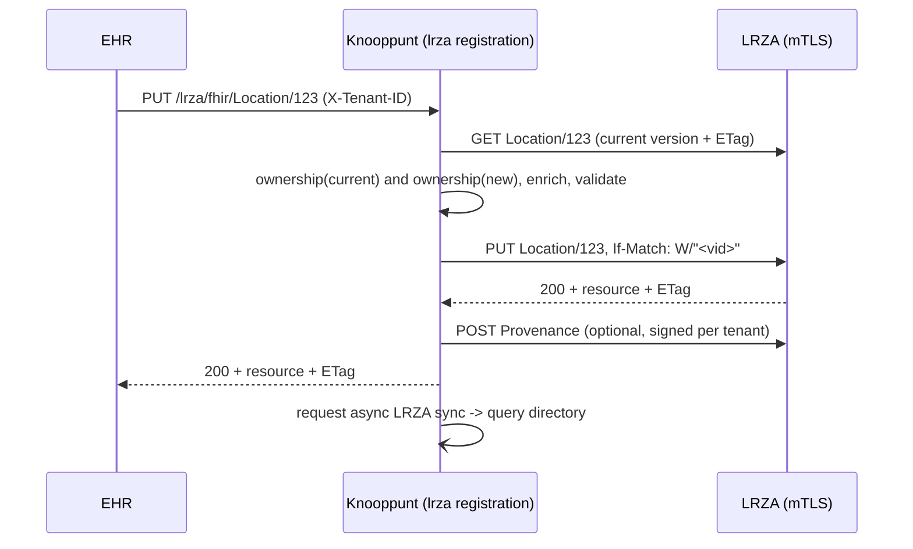

---
planStatus:
  planId: plan-lrza-registration-proxy
  title: LRZA registration proxy (write path to the Addressing directory)
  status: completed
  planType: feature
  priority: high
  owner: gandrejc
  tags: [addressing, lrza, fhir-proxy]
  created: "2026-10-20"
  updated: "2026-10-20"
  progress: 100
---

# LRZA registration proxy

## Context

Knooppunt already **reads** the LRZA. `component/lrza` syncs Organization, Location, HealthcareService, Endpoint and OrganizationAffiliation into the local query directory (Dirk's recent "Addressing v1.0.0" commits).

A client now also wants to **write** to the LRZA through Knooppunt: register and update its addressable entities in the LRZA Administration Directory. The spec is [csd.html](https://build.fhir.org/ig/minvws/generiekefuncties-docs/branches/1.0.0/en/csd.html), the ITI-130-NL "Data Source" role.

Knooppunt does the spec work so the EHR can send plain FHIR:
- mTLS
- nl-gf profiles and CustodianAssignedIdentifier shapes
- invariants
- If-Match / 412
- 429 Retry-After
- withdrawal by status instead of delete
- optional Provenance signing

Knooppunt acts as the **authorized party (IT vendor)**. One mTLS certificate serves many tenants, and each care provider grants the mandate through an OrganizationAffiliation that it creates itself. The LRZA authorizes the certificate, not the tenant. So Knooppunt must make sure each tenant writes only its own resources.

The API is modeled on the NVI gateway (`component/nvi/component.go`):
- typed OpenAPI operations in `openapi.yaml`
- served on the internal port through `strictAPIServer` (`cmd/apiserver.go`)
- an `X-Tenant-ID` header (`lib/tenants`)
- each request is rewritten before it is forwarded

Clients use **LRZA ids** directly, with no mapping to local query-directory ids.

## API (openapi.yaml, tag `lrza`, all with `X-Tenant-ID`)

`{resourceType}` is an enum: Organization | Location | HealthcareService | Endpoint. Bodies are `application/fhir+json`, using a new `FHIRResource` schema (`x-go-type: json.RawMessage`).

| Operation | operationId | Behavior |
|---|---|---|
| `POST /lrza/fhir` | `submitLrzaTransaction` | Transaction Bundle (all-or-nothing). Entries may use POST, PUT or DELETE (DELETE becomes a withdrawal PUT). |
| `POST /lrza/fhir/{resourceType}` | `createLrzaResource` | Create. Returns 201 with `Location` and `ETag`. |
| `GET /lrza/fhir/{resourceType}/{id}` | `readLrzaResource` | Read from the LRZA (authoritative, not the replica) and return `ETag`. Only for resources the tenant owns. |
| `PUT /lrza/fhir/{resourceType}/{id}` | `updateLrzaResource` | Update. Optional `If-Match` header. |
| `DELETE /lrza/fhir/{resourceType}/{id}` | `withdrawLrzaResource` | Turned into a status change (see below). Returns 200 with the withdrawn resource. |

Rejected with a 403 OperationOutcome:
- OrganizationAffiliation (the vendor may not write its own mandate)
- Provenance (Knooppunt creates these itself)
- Practitioner and PractitionerRole (out of scope of the CSD)

Errors are returned as `api.NewOperationOutcomeResponse` / `fhirapi.Error`. Status codes:
- 400 malformed
- 403 not the tenant's resource
- 422 failed local validation
- 412 stale version, passed through from the LRZA
- 429 and 5xx passed through after the retries are used up

Upstream OperationOutcomes are kept and passed on, so the client sees why the LRZA rejected a request.

## Processing pipeline (per resource; per entry for transactions)

1. **Ownership / tenant isolation** (`ownership.go`). An Organization is *tenant-owned* if it has an identifier `urn:oid:2.16.528.1.1007.3.3|<tenantURA>`, or if its `partOf` chain leads to one. The chain is walked upward with LRZA reads, depth capped at about 10, with a cache per request. In-bundle `urn:uuid:` references resolve against the bundle's own entries.
   - Organization: the new version must be tenant-owned. Changing or adding a different URA is rejected.
   - Location.managingOrganization, HealthcareService.providedBy and Endpoint.managingOrganization must point to a tenant-owned Organization.
   - Organization.endpoint[] and HealthcareService.endpoint[] may only link Endpoints the tenant manages, so a tenant cannot claim another tenant's endpoint.
   - On update and withdraw, the **current** LRZA version must also be tenant-owned, so a resource cannot be moved away from another tenant.
   - The tenant header keeps its existing system (`http://fhir.nl/fhir/NamingSystem/ura`). Comparison is by URA value against `coding.URAOIDNamingSystem` in the resources.
2. **Enrichment** (`enrich.go`). Fields the client set are never overwritten.
   - Add the nl-gf `meta.profile` canonical (`http://fhir.generiekefuncties.nl/csd/StructureDefinition/nl-gf-*`). Add these constants to `lib/profile/constants.go` under new names. The existing `NLGenericFunction*` constants still point at the old nuts-foundation URLs and are used by mcsdadmin.
   - URA identifier: change a legacy `http://fhir.nl/fhir/NamingSystem/ura` to the OID system, and set `use=official` and the custodian `assigner` as CustodianAssignedIdentifier requires. Use the same shape as `uraIdentifier`/`custodian` in `test/testdata/vectors/lrza/coding.go`, moved into `lib/coding` as shared helpers.
   - AssignedId slice (Location, HealthcareService, and a non-URA Organization): if missing, generate one with `use=official`, system `urn:ietf:rfc:3986`, value `urn:uuid:<uuid>`, and assigner = custodian(tenant URA). On update, carry over the AssignedId from the current version if the client left it out.
   - Endpoint: if `managingOrganization` is missing, set it to the tenant's URA Organization (looked up in the LRZA by identifier). For an `hl7-fhir-rest` connection with no `fhirVersion` in `payloadMimeType`, add `application/fhir+json; fhirVersion=4.0`.
3. **Local validation** (`validate.go`). Hand-coded and structural. A failure returns 422 with one OperationOutcome issue per problem, using the expression path. The LRZA stays the final validator, and its 422 is passed through.
   - Cardinalities from the profiles: Organization name/type/identifier, Location status/name/type/managingOrganization, HCS identifier/providedBy/type/name, Endpoint status/connectionType/payloadType/address/managingOrganization. `implicitRules` and `modifierExtension` must be absent.
   - Invariants:
     - `ura-identifier-or-partof`
     - `only-ura-identified-organization-can-refer-to-an-endpoint`
     - `org-2` / `org-3` (no `home` use)
     - `assigner-identifier-system`
     - at most one URA
   - Value sets are only checked on code **system** (for example connectionType ∈ {endpoint-connection-type, nl-gf-authorization-server-cs}; payloadType must have a coding from nl-gf-data-categories-cs or endpoint-payload-type). Full `memberOf` is left to the LRZA.
   - `mcsd/validator.go` is not reused. It uses the legacy URA system and rules specific to the update client.
4. **Optimistic locking**. A client `If-Match` is always forwarded unchanged. If it is absent, Knooppunt sends `W/"<versionId>"` of the version it just read for the ownership check. This also closes the gap between that check and the write. A 412 goes back to the client, with no automatic re-apply, because the client owns the merge. Transaction entries get `request.ifMatch` the same way.
5. **Withdrawal** (`withdraw.go`). DELETE reads the current version, then sets:
   - Organization and HealthcareService: `active=false`
   - Location: `status=inactive`
   - Endpoint: `status=off` and `period.end=now`

   It then PUTs with If-Match. In a transaction, a DELETE entry is rewritten to that PUT.
6. **Forwarding**. Use go-fhir-client with `fhirclient.RequestHeaders` (If-Match, `Prefer: return=representation`), `fhirclient.ResponseHeaders` (ETag, Location) and `fhirclient.ResponseStatusCode`.
7. **Retries**. The write client keeps the same mTLS, tracing and optional OAuth layering as `newSourceHTTPClient` (`component/lrza/component.go:149`). Extend `retryTransport` (`component/lrza/retry.go`) with a method-aware rule:
   - 429 is retried for every method, honoring `Retry-After`.
   - 5xx and network errors are retried only for GET, PUT and DELETE.

   POST (create or transaction) is never retried on 5xx, so no duplicates are created. The sync path is unchanged because it only uses GET.
8. **Sync after write**. After a successful write, request a sync without waiting for it. A buffered channel `syncRequests chan struct{}` (cap 1) is drained by a goroutine started in `Start()` and stopped in `Stop()`, which calls the existing `update(ctx)`. It holds `updateMux`, so it serializes with `/lrza/update`, and bursts collapse into one run. This only runs when `querybaseurl` is set. Config: `syncafterwrite` (default true).
9. **Provenance signing** (phase 2, `provenance.go`). Only for tenants with a signing key configured. After a successful write:
   - Take the stored resource from the response.
   - Canonicalize it per `json#static`: recursively strip `meta` and `.text`, then JCS. Reuse `gowebpki/jcs` as in `component/pseudonymisation/canonical.go`.
   - Build a detached JWS (RS256, protected header `alg`, `canon`, `sigT`, `srCms`, `x5c`) with `lestrrat-go/jwx/v2`, following the x5c/JWS pattern in `component/authn/oauth2.go`.
   - POST a Provenance with:
     - `target` = `Type/id/_history/vid`
     - `agent` (type author) and `signature.who` = the tenant's Organization reference plus its URA identifier
     - `signature.type` = 1.2.840.10065.1.12.1.1
     - `sigFormat` = `application/jose`
     - `targetFormat` = `application/fhir+json;canonicalization=…`
     - `data` = base64(compact JWS)

   For a transaction, each changed entry is signed after the response. Signing is optional in the spec, so a signing failure does not undo the mutation. It is logged, and the response gets an OperationOutcome warning issue (transactions) or a `Warning` header.

## Code layout

All of this lives in the existing `component/lrza` package, because it shares the LRZA base URL, mTLS config and retry transport. Each concern gets its own file:

- `component/lrza/registration.go`: the strict-server handlers (`SubmitLrzaTransaction`, `CreateLrzaResource`, …), the pipeline, and forwarding
- `component/lrza/ownership.go`, `enrich.go`, `validate.go`, `withdraw.go`, `provenance.go` (phase 2)
- `component/lrza/retry.go`: the method-aware retry rule
- `component/lrza/component.go`:
  - add `Registration RegistrationConfig \`koanf:"registration"\`` to `Config`, with `Enabled bool`, `SyncAfterWrite bool` and `Signing map[string]tlsutil.Config` (keyed by tenant URA; cert+key for phase 2)
  - add the write client and the sync-request goroutine
- `openapi.yaml`: the five operations, the `FHIRResource` schema, an optional `IfMatch` header parameter, and `ETag`/`Location` response headers. Then run `go generate ./api/...` to regenerate `api/server.gen.go`.
- `cmd/apiserver.go`: five forwarders. Each returns `errComponentDisabled` when `s.lrza == nil` **or** registration is disabled (expose `lrza.Component.RegistrationEnabled()`).
- `lib/coding`: URA / custodian identifier helpers (move them out of the testdata copy), `KVKOIDNamingSystem = "http://kvk.nl"`, and the CSD code-system constants.
- `lib/profile/constants.go`: the CSD 1.0.0 profile canonicals.
- Docs:
  - `docs/INTEGRATION.md`: a "Registering addressing resources in the LRZA" section with example requests, what Knooppunt fills in, and the error semantics
  - `docs/CONFIGURATION.md`: the `lrza.registration.*` keys
  - `config/knooppunt.yml`: a commented example
  - `docs/c4-diagram.dsl`: EHR → Knooppunt → LRZA write relation

Every Go command needs the `env -u GOROOT` prefix in this environment.

## Phasing

1. **Phase 1, core write path:**
   - OpenAPI operations
   - single create, read and update
   - ownership checks
   - enrichment and validation
   - If-Match
   - withdrawal
   - method-aware retry
   - sync after write
2. **Phase 2:**
   - transaction Bundles (resolving in-bundle references, rewriting entries per entry)
   - Provenance signing
3. **Possible follow-ups, out of scope:**
   - upsert by AssignedId (`identifier=` search, then create or update), so clients don't need to track LRZA ids
   - Organization/Endpoint linking helpers

## Verification

- **Unit tests** in `component/lrza`. Use an httptest fake LRZA as in the `component/nvi/component_test.go` style, with table tests for:
  - ownership: own org, a sub-org through partOf, a foreign URA, an attempt to move a foreign resource, linking a foreign endpoint
  - enrichment: profile, URA rewrite, AssignedId generation and carry-over, managingOrganization default, fhirVersion mime
  - validation: each invariant produces the right 422 issue
  - If-Match: forwarded unchanged, filled in from the read, 412 passed through
  - withdrawal: the status mapping for each type
  - `retry_test.go`: POST is not retried on 503 but is retried on 429; PUT is retried on 503
  - Provenance: the canonicalization and JWS round-trip, verified with the public key
- **E2E** `test/e2e/lrza/registration_test.go`, using the existing harness (`test/e2e/harness/entrypoint.go`, with `config.LRZA.Registration.Enabled = true`). The seeded HAPI `lrza-root-directory` partition acts as the LRZA, and HAPI honors If-Match.
  1. Create an Endpoint and a Location for the sunflower tenant through `/lrza/fhir`, then assert the stored resources carry the profile, AssignedId and managingOrganization.
  2. Link the Endpoint to sunflower's Organization (PUT).
  3. Assert that a write for care2cure's Organization with the sunflower tenant header returns 403.
  4. Assert that a PUT with a stale If-Match returns 412.
  5. Withdraw the Location, and assert `status=inactive` on the LRZA and, after the automatic sync, in the query directory (reuse `readLocalCopy` from `sync_test.go`).
- **Commands**: `env -u GOROOT go generate ./api/...`, `env -u GOROOT go build ./...`, `env -u GOROOT go test ./component/lrza/... ./cmd/...`, `env -u GOROOT go test ./test/e2e/lrza/...` (needs Docker).
- **Manual**: `docker compose up`, then curl `POST localhost:8081/lrza/fhir/Endpoint` with `X-Tenant-ID: http://fhir.nl/fhir/NamingSystem/ura|<ura>` against the proeftuin LRZA, using the configured client certificate.

## Open points to confirm with the client or the LRZA operator

- Whether the proeftuin LRZA accepts writes with our certificate, and which mandate (OrganizationAffiliation `code`) each tenant must grant before writes succeed. The spec's write path is mTLS-only today, and the authentication means are still open in epic #855. -> answer: make it part of knoppunt.yml
- Whose KvK is the URA identifier's assigner. The IG examples use 50000535; make it a constant. -> answer: make it part of knoppunt.yml
- Signing certificates per tenant (PKIo/UZI with the URA in the SAN). Phase 2 depends on the client supplying them.
